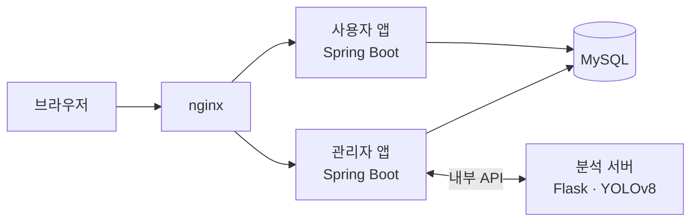

**명세에서 출발해 이슈·리뷰·CI로 팀 프로젝트를 이끌어 본 백엔드 개발자 박정호입니다.**

---

## 🚀 대표 프로젝트 — white-eyes

> 드론·CCTV처럼 높은 곳에서 찍은 영상에서 사람 수와 이동을 세고, 구역별 혼잡도와 이용 패턴을 통계로 보여 주는 서비스

**Stack**

**My Role — PM · 리뷰어 · 백엔드**
- **명세 → 이슈**: 요구·기능·API·테이블 명세를 md 문서 하나로 모으고, 기능 하나를 이슈 하나로 쪼개 프로젝트 보드에서 3단계로 일정 관리
- **코드 리뷰**: PR 리뷰 **271건**, 브랜치 룰셋(PR 필수·승인·코드 오너·CI `build` 통과)을 설계해 dev/main 품질 관리
- **결정 기록(ADR) 18건**: 혼잡 3단계 기준, 탐지 모델 교체(YOLO-CROWD → VisDrone YOLOv8m + PointTracker), 계정 테이블 분리 등 결정 이유를 문서로 남김
- **배포 구성**: 전체 서비스를 docker compose 한 번으로 띄우는 로컬 실행 환경, nginx 설정, 앱별 DB 계정

| 지난 1년 활동 | 커밋 | PR | 리뷰 | 이슈 |
|:-:|:-:|:-:|:-:|:-:|
| 2025.11 ~ 2026.11 | 338 | 109 | 271 | 149 |

🔗 [docs](https://github.com/white-eyes1/white-eyes-docs) · [spring](https://github.com/white-eyes1/white-eyes-spring) · [flask](https://github.com/white-eyes1/white-eyes-flask) · [deploy](https://github.com/white-eyes1/white-eyes-deploy)

---

## 🧩 그 밖의 프로젝트

| 프로젝트 | 한 줄 설명 | 스택 |
|---|---|---|
| [obsidian-shield](https://github.com/Kanabig/obsidian-shield) | TODO | Python · Flask · OpenCV · YOLO · InsightFace |
| [spring-boot-calendar-admin](https://github.com/Kanabig/spring-boot-calendar-admin) | TODO | Java · Spring Boot |
| [community-board-toy](https://github.com/Kanabig/community-board-toy) | TODO | Java |

---

## 🛠 Tech Stack

 

 

